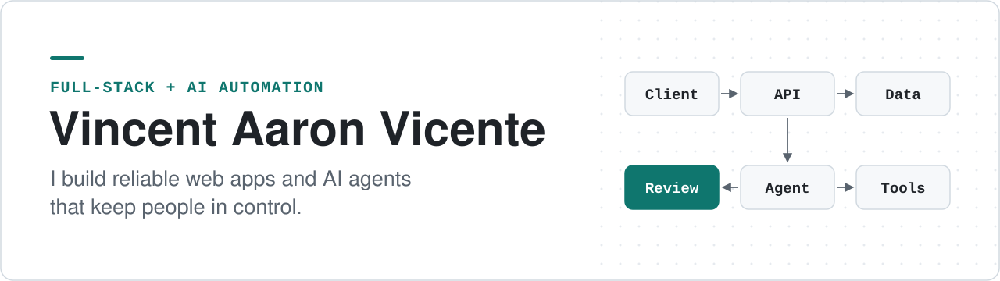

<picture>
  <source media="(prefers-color-scheme: dark)" srcset="assets/banner-dark.svg">
  <source media="(prefers-color-scheme: light)" srcset="assets/banner-light.svg">
  
</picture>

  
  
  

I'm a full-stack and AI automation developer from Bulacan, Philippines. I build web applications end to end, and LLM agents that handle real work while people stay in charge of the decisions.

**BS Information Technology, Cum Laude** · Bulacan State University

## Featured work

<table>
<tr>
<td width="50%" valign="top">

### [Vera Frei](https://github.com/vincent-aaron/vera-frei)
AI job-search agent with 31 tools. Finds and scores jobs, drafts applications, fills company forms and sorts employer replies, then waits for approval before acting. About 950 automated tests.

`Python` `LLM agents` `Playwright` `SQLite`

</td>
<td width="50%" valign="top">

### [Electro Galaxy](https://github.com/vincent-aaron/electro-galaxy)
Full-stack e-commerce platform with a product catalog, search, cart, checkout, accounts, order history and an AI shopping assistant.

`Next.js` `TypeScript` `Supabase` `Gemini API`

</td>
</tr>
<tr>
<td width="50%" valign="top">

### [Tech IMS](https://github.com/vincent-aaron/tech-ims)
Inventory system for computer laboratories with role-based access, equipment tracking, borrowing and returns, and a reporting dashboard.

`Python` `Django` `PostgreSQL`

</td>
<td width="50%" valign="top">

### [BPAMIS](https://github.com/vincent-aaron/barangay-adjudication-mis)
Capstone group project for managing barangay complaints, hearings and case records, with an AI chatbot and push notifications.

`PHP` `MySQL` `JavaScript` `OpenRouter API`

</td>
</tr>
</table>

## How I build

- **People stay in control.** AI agents show their plan and wait for approval before they act.
- **Tests come with the feature.** Automated checks cover the behavior that matters most.
- **Security is part of the design.** Role checks, separated user data and secrets kept out of code.

## Tech stack

**Languages**

<picture><source media="(prefers-color-scheme: dark)" srcset="assets/stack-languages-dark.svg"><source media="(prefers-color-scheme: light)" srcset="assets/stack-languages-light.svg"></picture>

**Web**

<picture><source media="(prefers-color-scheme: dark)" srcset="assets/stack-web-dark.svg"><source media="(prefers-color-scheme: light)" srcset="assets/stack-web-light.svg"></picture>

**Data**

<picture><source media="(prefers-color-scheme: dark)" srcset="assets/stack-data-dark.svg"><source media="(prefers-color-scheme: light)" srcset="assets/stack-data-light.svg"></picture>

**Tools**

<picture><source media="(prefers-color-scheme: dark)" srcset="assets/stack-tools-dark.svg"><source media="(prefers-color-scheme: light)" srcset="assets/stack-tools-light.svg"></picture>

**AI and automation**

LLM integration · Tool calling · AI agents · Playwright

## More projects

[RuneBound](https://github.com/vincent-aaron/runebound) (Unity, C#) · [LogPose](https://github.com/vincent-aaron/logpose) (Android, Firebase) · [Elevating IQ](https://github.com/vincent-aaron/elevating-iq) (Java) · [CineMax](https://github.com/vincent-aaron/cinemax) (Java Swing)
